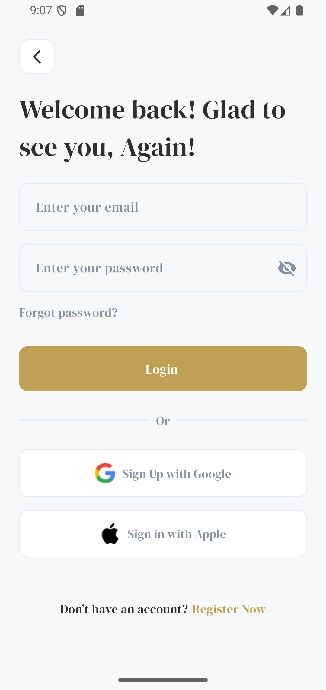
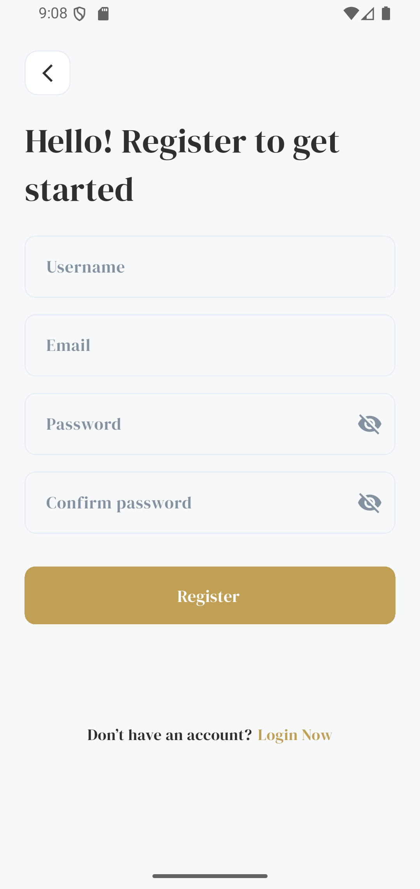
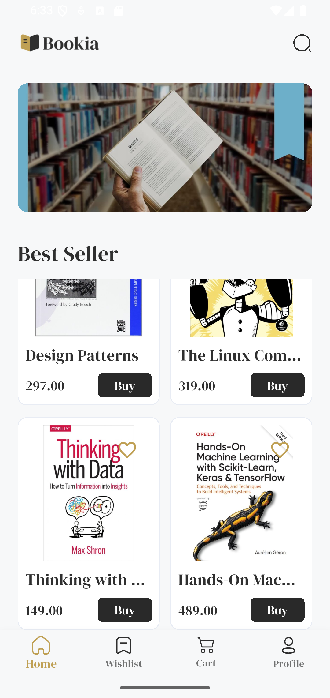
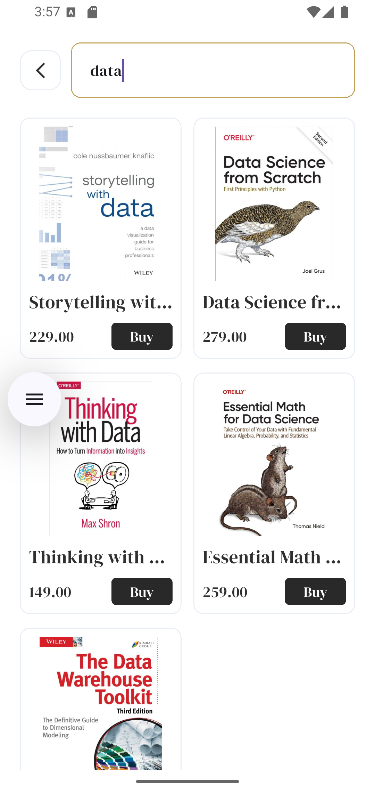
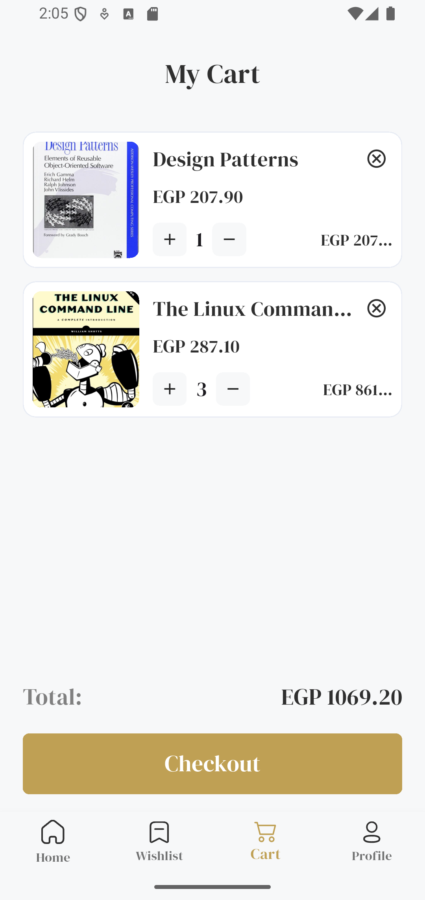
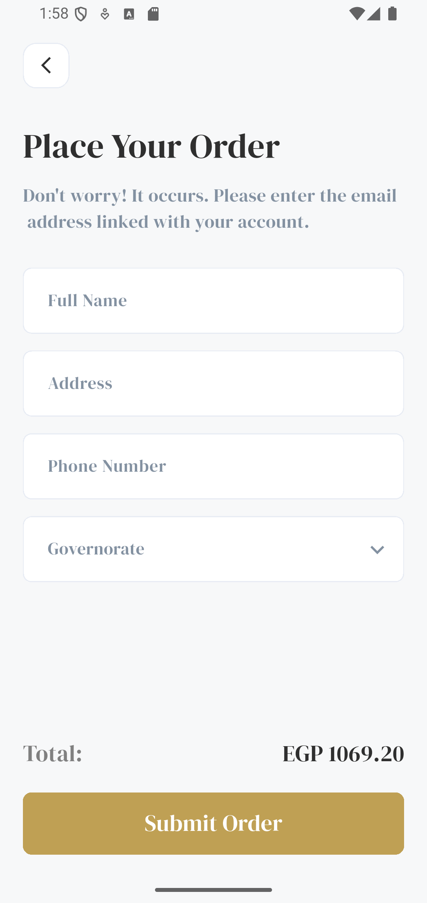
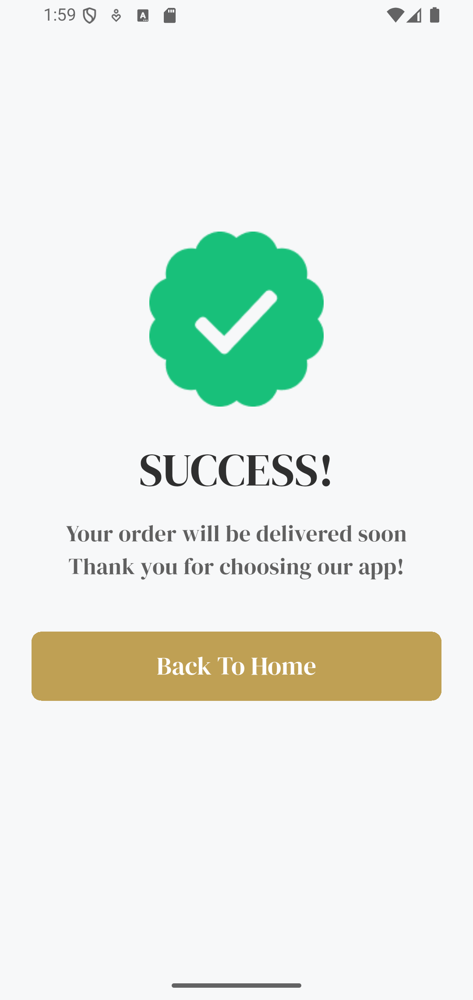
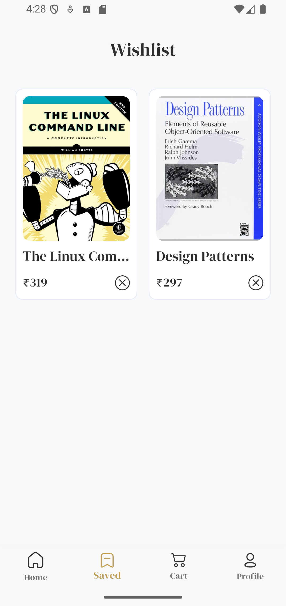
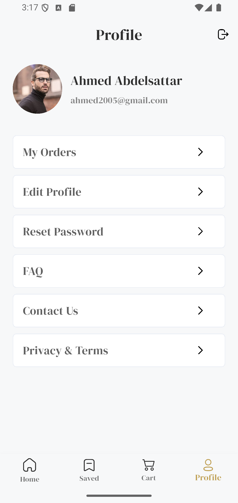

# 📚 Bookia – Book Store App

A modern **Flutter Book Store Application** that provides a smooth and user-friendly experience for browsing books, discovering bestsellers, managing favorites, and shopping online.

## ✨ Features

- 🔐 User Authentication (Login & Register)
- 🚀 Splash Screen & Onboarding
- 📚 Browse Books & Best Sellers
- 🔎 Search for Books
- 📖 Book Details
- 🛒 Add Books to Cart
- ❤️ Manage Wishlist
- 👤 User Profile
- 🌐 REST API Integration
- 🎨 Clean and Responsive UI

## 🛠️ Technologies & Tools

- **Flutter & Dart**
- **flutter_bloc** – State Management
- **Dio** – API Integration
- **Flutter ScreenUtil** – Responsive UI
- **REST API**
- **Git & GitHub**

## 📱 App Screens

### Splash & Onboarding

  
  

### Authentication

  
  

### Home & Search

  
 
  

### Book Details

  
  

### Cart 

  
  
  

### Wishlist

  

### Profile

  

